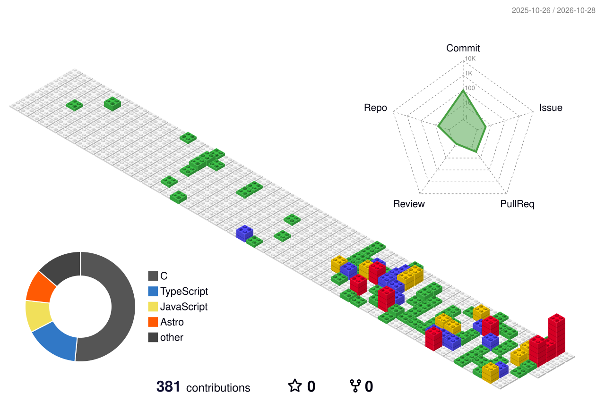

# Hi, I'm Sora Kondo 👋

## 🌐 Portfolio

## 📊 GitHub Stats

  
  
   
  

## 🛠️ Tech I've Worked With

Technologies I've used or explored in projects and personal experiments.

**Languages**

**Web & Frameworks**

**Embedded & Hardware**

**Development & Infrastructure**

## 🗓️ Isometric Calendar

<picture>
  <source media="(prefers-color-scheme: dark)" srcset="./profile-3d-contrib/profile-gitblock-dark.svg" />
  <source media="(prefers-color-scheme: light)" srcset="./profile-3d-contrib/profile-gitblock.svg" />
  
</picture>
