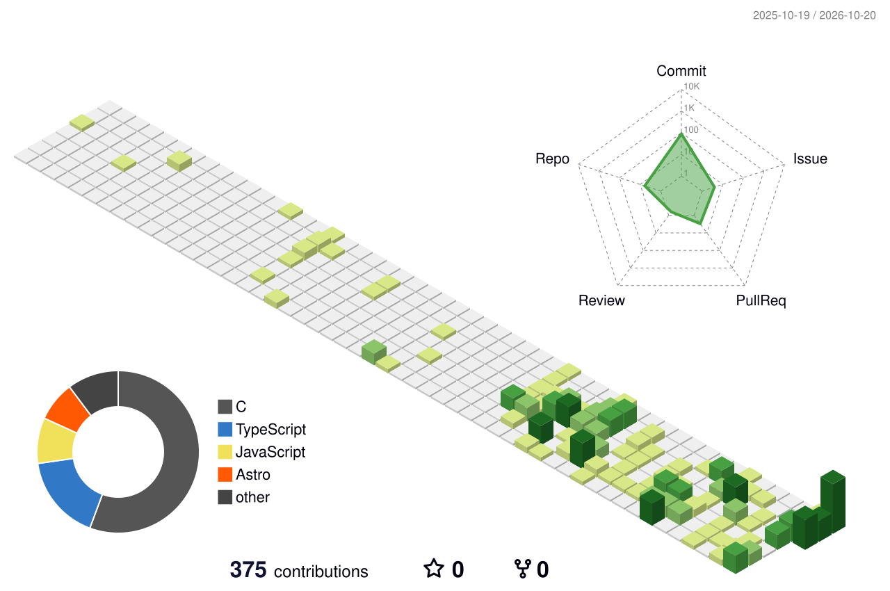

# Hi, I'm Sora Kondo 👋

## 🌐 Portfolio

## 📊 Most Used Languages

<a href="https://github.com/sorakondo?tab=repositories">
  <picture>
    <source media="(prefers-color-scheme: dark)" srcset="https://github-stats-extended.vercel.app/api/top-langs/?username=sorakondo&layout=compact&langs_count=8&theme=dark_github&hide_border=true" />
    
  </picture>
</a>

## 🛠️ Tech I've Worked With

Technologies I've used or explored in projects and personal experiments.

**Languages**

**Web & Frameworks**

**Embedded & Hardware**

**Development & Infrastructure**

## 🕒 Coding Habits

Commit activity by time of day (UTC).

<a href="https://github.com/sorakondo?tab=overview">
  <picture>
    <source media="(prefers-color-scheme: dark)" srcset="https://github-profile-summary-cards.vercel.app/api/cards/productive-time?username=sorakondo&theme=github_dark&utcOffset=0" />
    
  </picture>
</a>

## 🗓️ Isometric Calendar

<a href="https://github.com/sorakondo?tab=overview">
  <picture>
    <source media="(prefers-color-scheme: dark)" srcset="./profile-3d-contrib/profile-night-green.svg" />
    
  </picture>
</a>

## 📈 Activity Graph

<!-- Dynamic cards: https://github.com/stats-organization/github-stats-extended and https://github.com/Ashutosh00710/github-readme-activity-graph -->
